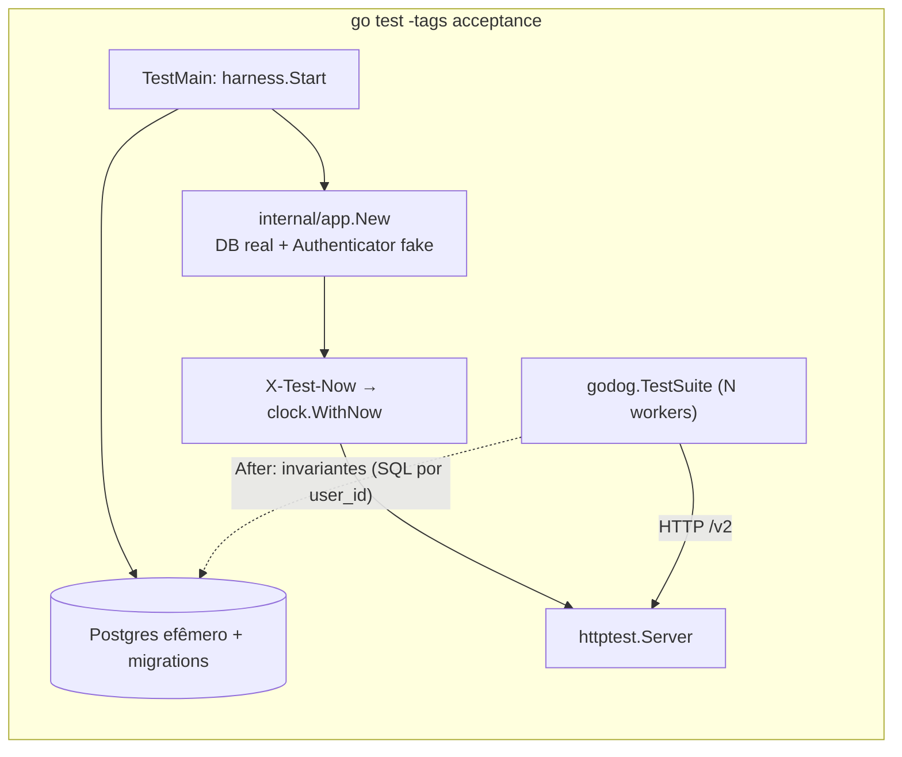

# Spec: Suíte de testes de aceite em Gherkin (parte da api)

> Doc único deste repo para a feature: o *o quê* congela ao virar `approved`; a checklist
> segue sendo marcada sem mudar o `status`.

## Objetivo

Suíte de aceite em Gherkin (inglês, godog) que sobe a api in-process contra um Postgres
efêmero e exercita, via HTTP nas rotas `/v2`, **sequências** de operações — com foco em
update e delete de `Movement` nas duas modalidades (*one* e *all-next*) cruzados com
`RecurrentMovement`, `CreditCard`/`Invoice`, parcelamento e `InternalTransfer`.

Decisões em `TDR-001`. Sem AYD: a suíte consome contratos `/v2` existentes
(`docs/swagger.yaml`) e não cria nem muda nenhum. Divergências reveladas seguem o fluxo
normal (correção em PR próprio; se mudar o comportamento observável, atualiza o contrato).

## Critérios de aceite

```gherkin
Feature: Acceptance test suite

  Scenario: The suite boots the API in-process against an ephemeral database
    Given Docker is available
    When I run "make test-acceptance"
    Then a Postgres container is started and every migration in db/migrations is applied
    And the API is built by the same composition root used by cmd/api
    And no .env file, Firebase project or external gateway credential is required

  Scenario: Unit tests stay independent from Docker
    When I run "make test"
    Then no acceptance package is compiled or executed

  Scenario: Scenarios are isolated by user
    Given two scenarios running concurrently
    Then each one acts as a distinct user and sees no data from the other

  Scenario: Each scenario has its own frozen clock
    Given a scenario declares "today is 2026-03-10"
    When the API reads the current date for a business rule
    Then it observes 2026-03-10, whatever date other concurrent scenarios declare

  Scenario: Production never honors test overrides
    Given the API is started by cmd/api in any environment
    Then the X-Test-Now header has no effect
    And authentication is performed by Firebase

  Scenario: Global invariants are verified after every scenario
    When any scenario finishes
    Then invoice amounts, card limits, wallet balances and transfer pairs are consistent

  Scenario: An unasserted failure fails the scenario
    Given a step receives a non-2xx response
    When the next step is not "the operation is rejected as ..."
    Then the scenario fails showing the response status and body

  Scenario: Known divergences do not block the pipeline
    Given a scenario tagged @known-bug
    When the default acceptance run executes
    Then that scenario is skipped
    And "make test-acceptance-known-bugs" runs it

  Scenario: The movement matrix is covered
    Then every cell of the coverage matrix has at least one scenario
```

## Contratos consumidos / expostos

Consumidos (só leitura do contrato). **Expostos:** nenhum — `X-Test-Now` e o formato do
`user_token` fake existem só no harness.

| Recurso | Rotas usadas |
|---|---|
| `Wallet` | `POST /v2/wallets/`, `GET /v2/wallets/:id` |
| `Category` / `Subcategory` | `POST /v2/categories/`, `POST /v2/subcategories/` |
| `CreditCard` | `POST /v2/creditcards/`, `GET /v2/creditcards/:id` |
| `Movement` | `POST /v2/movements/`, `GET /v2/movements/?from&to`, `PUT /:id`, `PUT /:id/all-next`, `DELETE /:id?date`, `DELETE /:id/all-next?date`, `POST /:id/pay?date`, `POST /:id/revert-pay` |
| `Invoice` | `GET /v2/invoices/detailed?from&to`, `POST /v2/invoices/:id/pay`, `/revert-pay`, `/recalculate` |
| `InternalTransfer` | `POST /v2/transfers/`, `PUT|DELETE /v2/transfers/:pair_id`, `POST /:pair_id/pay`, `/revert-pay` |

## Componentes afetados

- **Sem mudança de schema nem migration.**
- **Produção (refactor sem mudança de comportamento):** `internal/app` (composition root),
  `pkg/clock`, `environment.Test`, leituras de "hoje" migradas para `clock.Now(ctx)`.
- **Teste:** `test/acceptance/**` (harness, world, steps, features).
- **Build/CI:** `Makefile`, `.code_quality/.golangci.yml` (`build-tags: [acceptance]`),
  `.gitignore`, `.github/workflows/acceptance.yml`.

## Bordas e fora de escopo

- Valores em `float64`: comparação em centavos. Datas em UTC; `yyyy-mm` = `[dia 1, último dia]`.
- Leituras fora da transação e concorrência intra-usuário não são testadas.
- Categorias default (`user_id = default_category_id`) são só lidas; cada cenário cria as suas.
- Banco reaproveitado (`ACCEPTANCE_DATABASE_URL`): isolamento por usuário evita interferência.
- Docker indisponível: `TestMain` falha com mensagem explícita (sem skip silencioso).
- **Fora:** rotas legacy; `Statement`, `Agent`, `Subscription`, push, export, admin (dependem de
  gateways externos); corrigir as divergências; validação contra `swagger.yaml`; carga.

---

## Plano de implementação

### Abordagem



- **Processo** (`TestMain`): Postgres, migrations, app, servidor — uma vez.
- **Cenário** (`Before`/`After`): `World` com `user_id` novo e "hoje" `2026-01-15T12:00:00Z`;
  `After` checa pendência de resposta e invariantes.
- **Passo:** resolve aliases, chama a API, guarda a resposta; asserções leem a API (o banco
  só nas invariantes).

### Código de produção

```go
package app

type Config struct {
	DB            *gorm.DB
	Authenticator authentication.Authenticator
	Logger        log.Logger
}

func New(cfg Config) (*gin.Engine, error)
```

`cmd/api/main.go` mantém `godotenv`, logger, métricas, `InitializeDatabase`,
`NewFirebaseAuth` e `r.Run()`; todo o resto está em `app.New`.

```go
package clock

func WithNow(ctx context.Context, now time.Time) context.Context
func Now(ctx context.Context) time.Time // override do contexto ou time.Now()
```

Em produção ninguém chama `WithNow`. Auditoria (`date_create`/`date_update`) segue em
`time.Now()`. Leituras migradas:

| Call site | Regra |
|---|---|
| `invoice_usecase.go` (`Pay`) | `payment_date` padrão |
| `limits_usecase.go` | mês corrente em `GET /me/limits` |
| `registry/plan_limits_validator.go` | contagem mensal do plano `free` |
| `wallet_repository.go` | `initial_date` padrão e limite do recálculo de saldo |
| `domain/balance.go` | `Period.ValidateAt(now)`; callers `/v2` passam `clock.Now(ctx)`, `Validate()` legacy mantido |

`environment.Test = "test"`: o harness define `ENVIRONMENT=test` e se recusa a subir em
`production`. Nenhum usecase ou repositório consulta o ambiente.

### Harness (`test/acceptance/harness`)

| Arquivo | Responsabilidade |
|---|---|
| `harness.go` | `Start(ctx) (*Env, error)` / `Env.Close()` |
| `postgres.go` | testcontainers (`postgres:14.5-alpine`, usuário `silvioubaldino`) ou `ACCEPTANCE_DATABASE_URL` |
| `paths.go` | caminho das migrations a partir da raiz do repo (`runtime.Caller`) |
| `testauth.go` | `Authenticator` fake: `user_token` = `<user_id>` ou `<user_id>;plan=free` |
| `app.go` | wrapper HTTP: header `X-Test-Now` → `clock.WithNow` |
| `client.go` | cliente HTTP com `user_token` e `X-Test-Now`; `Response{Status, Body}` |

### World e regras de resolução

`World` viaja no `context.Context` do godog (nada global). Guarda `UserID`, `Plan`, `Now`,
aliases (carteiras, cartões, categorias, subcategorias, movimentos) e a última resposta.

- **Referências nos passos:** `"<alias>"`, `the occurrence of "<série>" in "<yyyy-mm>"`,
  `installment <k> of "<compra>"`, `the outgoing|incoming leg of "<transferência>"`.
- **Série = conjunto de descrições.** Update/delete quebram a cadeia e criam `recurrent_id`
  novos que a api não liga entre si; a ocorrência de um mês é o único movimento recorrente
  daquele mês cuja descrição pertence ao conjunto da série. Duas no mesmo mês é erro da suíte
  (acusa duplicata). Séries de um mesmo cenário têm descrições distintas.
- **Ocorrência virtual:** `GET /v2/movements` projeta as não materializadas com
  `id = recurrent_id`; update/delete usam esse id e a data da ocorrência.
- **Updates enviam o movimento completo** (estado lido + sobreposições): a api substitui
  os campos, não faz merge.
- **Resposta não asserida:** passos de ação nunca falham por status; se a resposta não é 2xx e
  o passo seguinte (ou o fim do cenário) não é `the operation is rejected as ...`, esse passo
  falha mostrando status e corpo.

### Organização

```
test/acceptance/
├── acceptance_test.go      harness/    world/    steps/
└── features/
    ├── wallet/       wallet_balance, wallet_plan_limit
    ├── movement/     create, pay, update_one, update_all_next, delete_one, delete_all_next
    ├── recurrence/   recurrent_projection, update_one_, update_all_next_, delete_one_, delete_all_next_
    ├── credit_card/  purchase_invoice_assignment, installments, invoice_payment,
    │                 update_/delete_credit_card_movement, paid_invoice_protection,
    │                 recurrent_credit_card (pendente: K6/K7/K9)
    ├── transfer/     internal_transfer
    └── journeys/     credit_card_month_cycle, salary_and_bills_cycle
```

Por capacidade de negócio, um arquivo por comportamento. Tags:

| Tag | Uso |
|---|---|
| `@movement` `@recurrence` `@credit-card` `@invoice` `@installments` `@transfer` `@wallet` | capacidade |
| `@update-one` `@update-all-next` `@delete-one` `@delete-all-next` | modalidade |
| `@invoice-paid` `@paid` `@virtual-occurrence` `@journey` | estado / jornada |
| `@known-bug` | comportamento desejado que hoje diverge — fora do gate |
| `@wip` | em construção — fora do gate |

### Estilo de escrita

- Inglês, declarativo, termos do glossário, sem HTTP no Gherkin; um comportamento por cenário.
- Datas sempre explícitas; nenhum cenário depende do dia real. Meio de jornada: `it is now "<date>"`.
- Frases usam `expense`/`income` com valor absoluto; tabelas e updates usam o valor com sinal
  (despesa negativa), como a api grava.
- Cenários independentes: o reuso é pelo vocabulário de passos, frase nova só se nenhuma serve.

### Vocabulário de passos (`test/acceptance/steps`)

| Grupo | Passos |
|---|---|
| Contexto | `today is "<date>"` · `it is now "<date>"` · `I am on the free plan` |
| Cadastro | `a wallet "<W>" with balance <n>` · `an expense\|income category "<C>"` · `a subcategory "<S>" of "<C>"` · `a credit card "<K>" with limit <n>, closing day <d> and due day <d>, paid from wallet "<W>"` |
| Movimento | `a pending\|paid expense\|income "<M>" of <n> on "<date>" in wallet "<W>" under category "<C>"` · `a pending\|paid monthly recurrent expense\|income "<R>" of <n> starting "<date>" ...` · `a credit card purchase "<M>" [in <k> installments] of <n> on\|starting "<date>" on card "<K>" under category "<C>"` |
| Ações | `I pay\|paid <ref> [on "<date>"]` · `I revert the payment of <ref>` · `I update only <ref> with:` / `setting amount to <n>` · `I update <ref> and all next with:` / `setting amount to <n>` · `I delete only <ref>` · `I delete <ref> and all next` |
| Fatura | `I pay\|paid the invoice of card "<K>" due in "<yyyy-mm>" from wallet "<W>" [paying <n>]` · `I revert the payment of the invoice ...` · `I recalculate the invoice ...` |
| Transferência | `a pending\|paid internal transfer "<T>" of <n> from "<W1>" to "<W2>" on "<date>"` · `I pay\|delete\|revert the payment of the internal transfer "<T>"` · `I update the internal transfer "<T>" with:` |
| Resultado | `the operation succeeds` · `the operation is rejected as "<reason>"`: `invalid input` 400 · `not found` 404 · `forbidden` 403 · `conflict` 409 · `insufficient balance` 422 · `insufficient limit` 422 |
| Asserções | saldo da carteira; limite disponível do cartão; fatura (valor, `paid\|open`, `does not exist`, `was paid on`, conjunto exato de faturas e de itens); ocorrências de série por mês; `<ref> is paid\|pending`; movimentos de uma carteira no mês |

### Invariantes (`After` de todo cenário, SQL por `user_id`)

| # | Invariante |
|---|---|
| **I1** | `invoices.amount` = Σ itens da fatura, exceto `invoice_payment` (regra do `/recalculate`) |
| **I2** | limite disponível do cartão = limite inicial + Σ faturas **não pagas** (vale com pagamento parcial e remanescente) |
| **I3** | `wallets.balance` = `initial_balance` + Σ movimentos **pagos**, exceto `credit_card` e `invoice_remainder` |
| **I4** | todo `pair_id` tem 2 pernas, valores opostos, carteiras distintas e mesmo `is_paid` |

### Matriz de cobertura (comportamento desejado)

Cada célula tem ao menos um cenário. `⚠ Kn` = divergência confirmada (ver abaixo).

| Contexto \ operação | update one | update all-next | delete one | delete all-next |
|---|---|---|---|---|
| **Avulso pendente** | só ele muda; saldo intacto | igual ao one | some; saldo intacto | igual ao one |
| **Avulso pago** | saldo ajusta pela diferença; troca de carteira estorna e lança | igual ao one | some; saldo estornado | igual ao one |
| **Série — 1ª ocorrência** | só o mês muda | série inteira muda ⚠ K13 | some o mês; série continua ⚠ K11 | série inteira some ⚠ K12 |
| **Série — virtual do meio** | mês materializado; vizinhos intactos | do mês em diante; anteriores intactos | só o mês some | do mês em diante some |
| **Série — ocorrência paga** | saldo ajusta pela diferença | saldo ajusta só no mês pago ⚠ K13 | saldo estornado; série continua | saldo estornado; série termina antes ⚠ K12 |
| **Compra em fatura aberta** | fatura e limite pelo delta ⚠ K15 (troca de período) | igual ao one ⚠ K4 | fatura e limite restaurados | igual ao one |
| **Compra em fatura paga** | `conflict` ⚠ K1 | `conflict` ⚠ K4 | `conflict` ⚠ K1 | `conflict` ⚠ K1 |
| **Parcela k de n (abertas)** | só a parcela e sua fatura | k..n e suas faturas ⚠ K5 | só a parcela | k..n somem; faturas e limite restaurados |
| **Parcela k, fatura de k+1 paga** | permitido | `conflict` inteiro ⚠ K4/K5 | permitido | `conflict` inteiro ⚠ K1 |
| **Recorrente no cartão** | pendente de decisão | pendente | pendente | pendente |
| **Perna de transferência** | `invalid input` | `invalid input` ⚠ K3 | `invalid input` | `invalid input` ⚠ K2 |

Fora da matriz, as features cobrem: pagamento de fatura total/parcial/revert (com remanescente),
saldo e limite insuficientes, pagar/reverter em estado errado, valor de pagamento fora da faixa,
subcategoria de outra categoria, plano `free`, data de pagamento = "hoje" do cenário.

### Divergências confirmadas

Cada uma tem cenário `@known-bug` (`make test-acceptance-known-bugs`); quando a correção entra
o cenário passa e a tag sai. Corrigir K1 muda status HTTP observável (500 → 4xx): a correção
atualiza `docs/swagger.yaml` no mesmo PR.

| # | Divergência | Onde |
|---|---|---|
| **K1** | Erros de regra sem mapeamento em `HandleErr` respondem `500` (fatura já paga/não paga, valor de pagamento inválido, limite insuficiente, item de cartão pago ou fatura paga ao alterar/apagar) | `errors_handler.go` |
| **K2** | `DELETE /:id/all-next` numa perna de transferência apaga uma perna só (sem o guard do `DELETE /:id`); quebra I4 | `deleteallnext_movement_usecase.go` |
| **K3** | `PUT /:id/all-next` numa perna de transferência atualiza uma perna só; quebra I4 | `updateallnext_movement_usecase.go` |
| **K4** | `PUT /:id/all-next` em compra de cartão não recorrente não ajusta fatura/limite e ignora fatura paga (responde `200` e marca o item como pago); quebra I1/I2/I3 | `updateallnext_movement_usecase.go` (`updateSingleMovement`) |
| **K5** | `PUT /:id/all-next` numa parcela atualiza só a parcela (*desejado a confirmar*, questão 1) | idem |
| **K11** | `DELETE /:id` da 1ª ocorrência apaga também ocorrências materializadas de meses posteriores (editadas ou pagas, estas sem estorno); quebra I3 | `deleteone_movement_usecase.go` (`splitRecurrentChain`) |
| **K12** | `DELETE /:id/all-next` no meio da série não remove ocorrência posterior já paga e não estorna; da 1ª, remove sem estorno; quebra I3 | `deleteallnext_movement_usecase.go` (`truncateRecurrentChain`) |
| **K13** | `PUT /:id/all-next` não reaponta ocorrência posterior já paga: duplica o mês; da 1ª, apaga a paga sem estorno | `updateallnext_movement_usecase.go` (`updateAllNextRecurrent`) |
| **K15** | `PUT /:id` de compra de cartão com data em outro período não troca a fatura | `updateone_movement_usecase.go` |

Sem cenário: **K6, K7, K9** (recorrente no cartão: `is_recurrent` é ignorado na compra de
cartão e delete não quebra cadeia) aguardam a questão 2; **K8** (fatura órfã) e **K10**
(`DeleteAllByRecurrentID` sem `user_id`) não são alcançáveis caixa-preta.

### Questões em aberto (decisão de produto)

1. **K5** — update all-next numa parcela k deve reescrever k..n?
2. **K6/K7/K9** — "despesa recorrente no cartão" é suportada? Se sim, como nasce e o que
   delete one/all-next fazem com a cadeia? (Bloqueia `recurrent_credit_card.feature`.)
3. **K1** — status desejados: `409` para estado, `422` para limite, `400` para valor fora da faixa?

### Execução e CI

| Alvo / variável | Efeito |
|---|---|
| `make test-acceptance` | gate: `~@known-bug && ~@wip` |
| `make test-acceptance-wip` / `-known-bugs` | só `@wip` (verboso) / só `@known-bug` |
| `GODOG_TAGS` · `GODOG_CONCURRENCY` (padrão 4) | tags e paralelismo |
| `ACCEPTANCE_DATABASE_URL` · `ACCEPTANCE_LOG_LEVEL` | Postgres existente · log da app (padrão `fatal`) |

`.github/workflows/acceptance.yml` roda em todo push: job `acceptance` (gate) e job
`known-bugs` com `continue-on-error`. Relatórios (junit/cucumber) em `test/acceptance/reports/`.

### Arquivos afetados

`cmd/api/main.go` · `internal/app/app.go` · `pkg/clock/**` · `internal/bootstrap/environment` ·
call sites da tabela de relógio (`usecase/{invoice,limits,dashboard,balance}`,
`registry/plan_limits_validator.go`, `repository/wallet_repository.go`, `domain/balance.go`,
`api/{movement,invoice}_api.go`) · `test/acceptance/**` · `go.mod`/`go.sum` (godog,
testcontainers; `pgx` sobe de 5.7.4 para 5.9.2 por dependência do testcontainers) · `Makefile` ·
`.code_quality/.golangci.yml` · `.gitignore` · `.github/workflows/acceptance.yml` ·
`docs/conventions/testing.md` · `CLAUDE.md` · `CHANGELOG.md`.

### Testes

- **Aceite:** boot, isolamento, relógio, invariantes e resposta não asserida são exercidos por
  toda execução de `make test-acceptance`; `@known-bug` fora do gate pelas tags padrão e pelo
  job separado; matriz coberta pelas features.
- **Unit:** `pkg/clock` e `Period.ValidateAt`; testes existentes seguem iguais.
- **Baseline:** `make all` não fica verde por motivo anterior a esta SPEC — testes legacy de
  `internal/domain/{category,estimate,movement}` não compilam e `.golangci.yml` está no formato v1
  enquanto o golangci-lint instalado é v2.

### Checklist

- [x] Fase 0 — `app.New`, `environment.Test`, `pkg/clock` + call sites + `Period.ValidateAt`
- [ ] Fase 0 — `make all` verde (parcial: build e testes iguais ao baseline; ver Testes)
- [x] Fase 1 — dependências, harness, `World`/hooks/resposta não asserida, `Makefile`/lint/`.gitignore`
- [x] Fase 2 — passos de movimento/série, `movement/*`, `recurrence/*`, invariante I3
- [x] Fase 3 — passos de cartão/fatura/transferência, `credit_card/*` (exceto `recurrent_credit_card`), `transfer/*`, I1/I2/I4
- [ ] Fase 3 — questões em aberto 1–3 decididas e `recurrent_credit_card.feature` escrito
- [x] Fase 4 — `journeys/*`, workflow de CI (1ª execução real no próximo push), `testing.md` + `CLAUDE.md`
- [x] Linha no `CHANGELOG.md`
