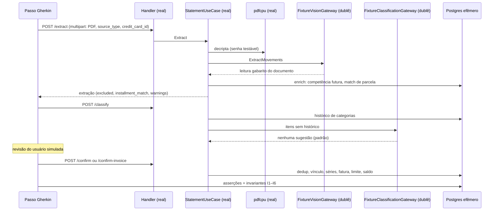

# Spec: Testes de aceite determinísticos do import (parte da api)

> **Doc único deste repo para a feature:** o *o quê* (objetivo, critérios, contratos) e o
> *como* (plano de implementação). A parte "o quê" **congela ao virar `approved`**; a
> checklist do plano segue sendo marcada durante a execução, sem mudar o `status`.

## Objetivo

O import de documento financeiro (`Statement` e `Invoice`) tem duas metades:

1. **a IA lê o documento** — probabilística, varia entre leituras;
2. **o sistema decide o que entra, onde entra e como** — deve ser determinística, e é a metade
   que corrompe dados quando erra: duplica série de parcelas, perde item, infla fatura, consome
   limite, desloca saldo.

Esta SPEC estende a suíte Gherkin do SPEC-008 para validar **só a segunda metade**. A IA é
substituída por um dublê que devolve exatamente o que o documento contém. Cada cenário responde
a uma pergunta: *dado que a IA leu X, o app ficou certo?*

Medir a qualidade da IA (prompt, OCR, leitura de layout) fica fora.

### Propriedades que a suíte garante

Valem para extrato e fatura, salvo indicação. Cada cenário declara as que exercita.

| # | Propriedade | Verificação |
|---|---|---|
| **P1 Completude** | Todo item que pertence ao documento vira valor no app, **mesmo sem categoria entendida e com nome ilegível**. Na fatura, a fatura da competência no app fecha com o total do documento. No extrato, o saldo da carteira muda exatamente pela soma das linhas | asserção de cenário |
| **P2 Sem duplicação** | Reimportar não cria nada. A parcela de uma série conhecida vincula em vez de criar. Nenhuma série tem duas parcelas com o mesmo número | invariante I5 e asserção |
| **P3 Associação** | Parcela já registrada (à mão ou por import anterior) é vinculada e tem o valor corrigido; `description`, `date` e `is_paid` ficam intactos. No extrato, linha vinculada a recorrência atualiza a ocorrência do mês | asserção |
| **P4 Exclusão** | O que não pertence ao documento (pagamento da fatura anterior, parcela de competência futura) não entra, **mesmo que o cliente insista** | asserção |
| **P5 Consistência contábil** | Depois de qualquer import valem fatura = Σ itens (I1), limite (I2) e saldo (I3) | invariantes do SPEC-008 |
| **P6 Categoria nunca bloqueia** | Sem sugestão, o item vai para a categoria de fallback pelo sinal (AYD-006). Com histórico, usa a categoria do histórico | asserção |
| **P7 Determinismo** | Mesmo documento e mesmo estado dão o mesmo resultado. Sem rede e sem IA, roda no CI atual sem segredo | arquitetura |

## Critérios de aceite

```gherkin
Cenário: A suíte de import roda sem IA e sem rede
  Dado o CI de aceite sem credenciais do Google Cloud
  Quando make test-acceptance roda
  Então os cenários de import passam sem chamar o Gemini

Cenário: Produção continua usando o Gemini
  Dado app.New sem override de gateways
  Quando o import é chamado
  Então os gateways usados são GeminiVisionGateway e GeminiClassificationGateway

Cenário: Cada fixture é íntegra
  Dado uma fixture em test/acceptance/fixtures/import/<id>/
  Quando o teste de integridade roda
  Então o ID nos metadados do PDF é <id>
  E a soma dos itens não excluídos do gabarito é o total declarado (salvo fixture marcada como divergente)

Cenário: PDF desconhecido falha o cenário
  Dado um PDF sem ID de fixture registrado no dublê
  Quando o passo de import o envia
  Então o cenário falha com erro explícito, sem extração vazia silenciosa

Cenário: Invariantes de série e de hash valem em toda a suíte
  Dado qualquer cenário da suíte, de import ou não
  Quando ele termina
  Então I5 e I6 são verificadas junto com I1–I4

Cenário: Toda propriedade e todo risco têm cenário
  Dado o catálogo de cenários desta SPEC
  Então P1–P7 têm ao menos um cenário cada
  E R1–R7 têm ao menos um cenário cada, marcado @known-bug ou @wip conforme a triagem
```

## Contratos consumidos/expostos

**Consumidos** (só leitura, definidos no AYD-004@context): `POST /v2/statements/extract`,
`/classify`, `/confirm` e `/confirm-invoice`, além das rotas de cadastro e consulta já usadas
pelo SPEC-008 (`Wallet`, `Category`, `CreditCard`, `Invoice`, `Movement`).

**Expostos:** nenhum. O override de gateways em `app.Config` é injeção de dependência interna;
nenhum endpoint, payload ou enum muda.

## Modelo de dados / componentes afetados

- **Produção (só a costura):** `internal/app/app.go` (`Config.StatementGateways`),
  `internal/bootstrap/setup.go` (opção funcional em `SetupCleanArchComponents`),
  `internal/bootstrap/statement/setup.go` (usa o override quando presente).
- **Harness:** `test/acceptance/harness` (dublês `FixtureVisionGateway` e
  `FixtureClassificationGateway`; envio multipart no `Client`).
- **Passos e invariantes:** `test/acceptance/steps` (passos de import, I5, I6).
- **Fixtures:** `test/acceptance/fixtures/import/` (`document.yaml`, `document.pdf`,
  `extraction.json`, gerador).
- **Features:** `test/acceptance/features/import/{invoice,statement}/` e
  `features/journeys/invoice_import_three_months.feature`.

## Casos de borda & fora de escopo

- **Borda:** PDF com senha usa o mesmo gabarito da versão aberta — a identificação é pelo
  metadado, que sobrevive à decriptação.
- **Borda:** cenários rodam em paralelo (`GODOG_CONCURRENCY=4`); o registro do dublê é por ID
  único de cenário.
- **Borda:** comportamento desejado ainda sem decisão de produto não vira asserção inventada:
  o cenário leva `@wip`.
- **Fora:** qualidade da IA (prompt, OCR, leitura de layout). Não há perfil com Gemini real; os
  PDFs continuam servindo ao teste manual com a IA real, fora da suíte.
- **Fora:** fixtures de imagem (JPEG/PNG) — o mecanismo serve igual, fica para depois.
- **Fora:** UI de web e mobile.
- **Fora:** extrato contendo o pagamento da fatura × itens importados da fatura (achado 6 do
  AYD-004) e `InternalTransfer` reconhecida em extrato.
- **Fora:** as correções de R1–R7. Vão em PRs próprios, que tiram a tag do cenário (regra do
  SPEC-008); esta SPEC só os torna visíveis e reproduzíveis.

---

## Plano de implementação

### Abordagem técnica

#### Onde a IA é cortada



Só os dois gateways Gemini são trocados. Todo o resto roda como em produção: handler,
validação de tamanho e mime, decriptação pelo pdfcpu, marcação de pagamento, checksum do total,
competência futura, matcher de parcela, classificação por histórico, dedup e persistência.

#### Costura no código de produção

Hoje `statement.Setup` constrói `GeminiVisionGateway` e `GeminiClassificationGateway`
diretamente, e `app.Config` não oferece como trocá-los. Proposta:

- `app.Config` ganha um campo opcional `StatementGateways` (`Vision`, `Classification`).
  `nil` significa Gemini, como hoje.
- `bootstrap.SetupCleanArchComponents` recebe o override por **opção funcional variádica**,
  então `cmd/api/main.go` não muda.
- `statement.Setup` usa o override quando presente; senão constrói o Gemini como hoje.

Isso segue a regra da skill `go-bootstrap`: gateway externo continua construído no `Setup` da
feature e nunca fica memoizado no `Registry`. As interfaces `StatementVisionGateway` e
`StatementClassificationGateway` já existem no usecase; o dublê só as implementa.

#### Dublê de visão: `FixtureVisionGateway`

Devolve, para cada documento recebido, a **leitura gabarito**: o `StatementExtractResult` que
uma IA perfeita devolveria.

- **Identificação:** por um ID gravado nos metadados do PDF (`/Subject: pf-fixture:<id>`), não
  por hash dos bytes. O metadado sobrevive à decriptação do pdfcpu, então a versão com senha
  usa o mesmo gabarito.
- **Duas fontes de gabarito, mesmo mecanismo:**
  1. **Arquivo:** `extraction.json` da fixture, gerado junto com o PDF (§Fixtures). Serve às
     jornadas realistas.
  2. **Tabela no cenário:** o passo registra a leitura no dublê sob um ID único do cenário e
     sobe um PDF mínimo com esse ID. Serve aos casos de borda e à **leitura imperfeita** (item
     parcelado sem `installment_number`, nome truncado, total com sinal trocado), sem exigir
     um PDF por caso.
- **Concorrência:** o registro é por ID único, então é seguro com `GODOG_CONCURRENCY=4`.
- **Erro explícito:** PDF com ID desconhecido falha o teste. Nunca devolve vazio em silêncio.

#### Dublê de classificação: `FixtureClassificationGateway`

Por padrão **não sugere nada**, o que força o caminho "a IA não entendeu a categoria" (P6). O
cenário pode declarar sugestões (`And the AI suggests category "Transport" for "UBER *TRIP"`).
A classificação **por histórico** vem do banco e roda de verdade.

#### Revisão do usuário simulada

Entre `extract` e `confirm`, web e mobile mostram a revisão. O passo de import reproduz o
**cliente padrão**:

- manda tudo o que veio;
- preserva `excluded`;
- mantém o `installment_group_id` pré-preenchido;
- aplica as sugestões de categoria.

Desvios do padrão são passos explícitos:

| Passo | Efeito no payload do confirm |
|---|---|
| `I accept the suggested link for "<item>"` | `installment_group_id` ← grupo de `installment_match` |
| `I reject the link for "<item>"` | `installment_group_id` ← vazio |
| `I link "<item>" to the purchase "<M>"` | vínculo manual a uma série existente |
| `I re-include "<item>"` | `excluded` ← `false` (o servidor deve recusar mesmo assim, P4) |
| `I link the line "<item>" to the recurrent expense "<R>"` | `recurrence_id` (extrato) |

Assim o ciclo inteiro roda sem HTTP no Gherkin, como pede o SPEC-008.

#### Por que PDF, se a IA é dublê

O PDF não é lido pelo dublê, mas paga o custo:

- exercita o upload multipart real, a validação de tamanho e mime e a **decriptação real**
  (cenários de senha);
- é a versão legível do gabarito: quem revisa um cenário abre o PDF e vê o que o app recebeu;
- os mesmos arquivos servem ao teste funcional manual com a IA real e à UI de web e mobile.

### Vocabulário de passos (novo)

**Import**
- `I import the invoice "<fixture>" into card "<K>"`: extract (`source_type=invoice`,
  `credit_card_id`), classify, revisão padrão e `confirm-invoice`.
- `I import the statement "<fixture>" into wallet "<W>"`: extract (`source_type=statement`),
  classify, revisão padrão e `confirm`.
- Em duas etapas, quando o cenário precisa inspecionar a extração:
  `I extract the invoice "<fixture>" for card "<K>"`, depois as asserções, depois
  `I confirm the import`.
- Inline: `I import an invoice into card "<K>" read as:` com a tabela
  `| date | description | amount | installment |` e o complemento opcional
  `declaring total <n>`. O equivalente para extrato é `a statement into wallet "<W>"`.
- Sufixo opcional no upload: `with password "<p>"`.

**Asserções**
- `the extraction marks:` com a tabela `| description | as |`, onde `as` é um de
  `invoice payment`, `future installment`, `linked to "<M>"`, `suggested "<M>"` ou `new`.
- `the import created <n> and skipped <m>`.
- `the invoice of card "<K>" due in "<yyyy-mm>" matches the document total` (P1).
- `every item of the document is in the app` (P1): cada item não excluído do gabarito tem um
  movimento correspondente, criado ou vinculado.
- `the installments of "<M>" on card "<K>" are:` com a tabela `| installment | due | amount |`
  (P2, P3).
- `"<item>" is in category "<C>"` (P6).
- Os passos existentes de fatura, limite, saldo e `the operation is rejected as` são reusados.

### Invariantes novas

Somam-se às I1–I4 do SPEC-008 e rodam no `After` de **todo** cenário da suíte, não só nos de
import:

| # | Invariante |
|---|---|
| **I5** | Em cada `installment_group_id`: `installment_number` único e dentro de `1..total_installments`; todas as parcelas com o mesmo `total_installments` e o mesmo cartão |
| **I6** | `idempotency_hash` único por usuário |

A I5 pega duplicação de série em qualquer cenário, inclusive nos que não a procuram.

### Fixtures

#### Geração

- **Fonte única:** `test/acceptance/fixtures/import/<id>/document.yaml` (cartão ou carteira,
  período, itens). Dela saem:
  - `document.pdf`: layout do Inter para fatura e um extrato bancário genérico para statement;
  - `extraction.json`: a leitura gabarito que o dublê devolve.

  PDF e gabarito não divergem porque nascem do mesmo arquivo.
- **Gerador:** Python, HTML e Chromium headless (o mesmo motor que gerou a fatura usada como
  molde), em `test/acceptance/fixtures/import/generator/`. É ferramenta de dev: o CI não roda o
  gerador, e os arquivos gerados são versionados. Itens "aleatórios" usam semente fixa, então
  regerar dá o mesmo PDF.
- **Mais leves que o original:** 2 a 3 páginas, sem imagem nem QR code. Ficam só as seções que
  importam ao import:
  - resumo (total, vencimento, limite);
  - "Despesas da fatura" com **dois cartões** (titular e adicional) e subtotal de cada;
  - "Próxima fatura".
- **Convenções do Inter preservadas:**
  - data `17 de set. 2026`;
  - parcela `(Parcela 04 de 06)`, datada pela **data da compra original**;
  - crédito como `+ R$`;
  - descritores de adquirente (`UBER *TRIP`, `IFD*`, `MERCADOLIVRE*`, `MP *CONECTCAR`,
    `DL*GOOGLE`);
  - encargos (IOF, juros).
- **Dados 100% fictícios** (titular, finais de cartão, linha digitável). A fatura real usada
  como molde **não entra no repo**.

#### Linha do tempo

Um cartão "Inter" (fechamento dia 3, vencimento dia 10, limite 5.000,00) e uma carteira
"Checking", ao longo de três meses seguidos. As parcelas avançam entre as faturas como no mundo
real.

| Fixture | Conteúdo | Serve a |
|---|---|---|
| `inter-2026-08` | ~18 itens em 2 cartões; 2 parceladas novas (`01 de 03`, `SAMSUNG*LOJA 01 de 10`); 1 parcela de compra anterior ao app (`04 de 06`); `PAGAMENTO ON LINE`; estorno; 2 pedágios idênticos no mesmo dia; IOF e juros | base, exclusões, idênticos, parcelada nova |
| `inter-2026-09` | Continua as séries (`02 de 03`, `02 de 10`, `05 de 06`), uma com centavos diferentes; 1 parcelada nova; seção "Próxima fatura" | vínculo, delta |
| `inter-2026-10` | Fecha séries (`03 de 03`, `06 de 06`) e traz `03 de 10` | convergência e término |
| `inter-2026-08-protegida` | `inter-2026-08` com senha | decriptação real com o mesmo gabarito |
| `extrato-2026-08` | Conta corrente: salário, PIX, boleto, Netflix e aluguel (recorrentes), `PAG FATURA CARTAO`, 2 PIX idênticos no mesmo dia | extrato base, recorrência, idênticos |
| `extrato-2026-08-segunda-quinzena` | Período sobreposto ao anterior (dias 10 a 31) | sobreposição sem duplicar |

Os casos de borda usam tabela inline e dispensam PDF: competência futura, total divergente,
falsos positivos (`PAGUE MENOS`, `PAGSEGURO`, `PAGBANK`) e leitura imperfeita.

### Catálogo de cenários

Pastas: `features/import/invoice/`, `features/import/statement/` e `features/journeys/`.

Cada cenário descreve o comportamento **desejado**. Onde a api diverge:
- se o desejado **já está decidido**, o cenário leva `@known-bug` e entra na tabela de
  divergências do SPEC-008;
- se o desejado **ainda não foi decidido**, leva `@wip` e fica como questão em aberto aqui. Um
  teste não inventa decisão de produto.

#### Fatura

| Feature | Cenários | Prop. |
|---|---|---|
| `invoice_import` | Todos os itens entram e a fatura fecha com o total do documento · item sem categoria vai para o fallback pelo sinal · nome ilegível é registrado como veio · compras dos 2 cartões físicos vão para o mesmo `CreditCard` · limite consumido = total importado | P1 P5 P6 |
| `invoice_import_idempotency` | Reimportar a mesma fatura não cria nada e não mexe em fatura nem limite · reimport de correção (o primeiro import perdeu 1 linha) cria só a que faltava · reimport com a IA lendo o nome com outra pontuação (R5) | P2 |
| `invoice_import_installments` | Parcelada nova cria a série restante · compra registrada à mão com o mesmo nome vincula sozinha (R7) · compra registrada como "Notebook" vem sugerida: aceitar vincula, recusar cria série nova · centavos de arredondamento ajustam só a parcela, e fatura e limite pelo delta · parcela de compra anterior ao app (`04 de 06`) cria só 4..6 · vínculo inválido cai na criação · parcela datada pela compra original entra na fatura importada (R1) | P2 P3 |
| `invoice_import_exclusions` | Pagamento anterior é marcado e não importado · cliente re-inclui o pagamento e o servidor recusa · `PAGUE MENOS`, `PAGSEGURO` e `PAGBANK` entram · parcela de competência futura é excluída, compra comum na mesma data entra · estorno reduz a fatura e devolve limite | P4 P5 |
| `invoice_import_identical_items` | Dois pedágios iguais no mesmo dia entram os dois · reimportar continua sem duplicar (R2) | P1 P2 |
| `invoice_import_rejections` | Estouro de limite é rejeitado e nada do item é criado · cartão sem carteira default é rejeitado · fatura já paga (`@wip`, achado 4 do AYD-004) · PDF com senha: ausente, errada, certa | P5 |
| `invoice_import_imperfect_reading` | Parcelada lida sem `installment_number`, com a parcela só no texto (R6) · total declarado com sinal trocado não gera aviso · data ilegível em 1 item: só ele é pulado, os outros entram (R4) | P1 P2 |

#### Extrato

| Feature | Cenários | Prop. |
|---|---|---|
| `statement_import` | Todas as linhas entram pagas na carteira, com saldo = inicial + Σ · entrada sem categoria vai para o fallback de receita (AYD-006) · linha já categorizada no passado usa o histórico · plano `free` para no teto e reporta o resto | P1 P5 P6 |
| `statement_import_idempotency` | Reimport não cria nada · extratos com período sobreposto não duplicam a interseção | P2 |
| `statement_import_recurrence` | Linha vinculada a recorrência atualiza a ocorrência do mês, sem duplicar · reimportar o extrato sem refazer o vínculo não duplica a ocorrência (R3) | P2 P3 |
| `statement_import_identical_lines` | Dois PIX iguais no mesmo dia entram os dois (R2) | P1 |

#### Jornada

`invoice_import_three_months`, em sequência:
1. importa a fatura de ago;
2. registra uma compra parcelada à mão;
3. importa a fatura de set;
4. paga a fatura de ago;
5. importa a fatura de out.

A cada passo, a fatura bate com o total do documento, nenhuma série tem duplicata (I5), o
limite fecha (I2) e as séries convergem e terminam no número certo.

#### Exemplos

```gherkin
@import @invoice @installments
Scenario: An installment purchase registered by hand is linked, not duplicated
  Given today is "2026-09-05"
  And a credit card purchase "SAMSUNG*LOJA" in 10 installments of 349.90 starting "2026-07-20" on card "Inter" under category "Electronics"
  When I import the invoice "inter-2026-09" into card "Inter"
  Then the extraction marks:
    | description                     | as                       |
    | SAMSUNG*LOJA (Parcela 02 de 10) | linked to "SAMSUNG*LOJA" |
    | PAGAMENTO ON LINE               | invoice payment          |
  And the installments of "SAMSUNG*LOJA" on card "Inter" are:
    | installment | due     | amount  |
    | 1           | 2026-08 | -349.90 |
    | 2           | 2026-09 | -349.93 |
    | 3           | 2026-10 | -349.90 |
    | ...         | ...     | ...     |
  And the invoice of card "Inter" due in "2026-09" matches the document total

@import @invoice @identical
Scenario: Two identical tolls on the same day are both imported
  Given today is "2026-08-05"
  When I import an invoice into card "Inter" read as:
    | date       | description   | amount |
    | 2026-07-19 | MP *CONECTCAR | -4.37  |
    | 2026-07-19 | MP *CONECTCAR | -4.37  |
  Then the import created 2 and skipped 0
  And every item of the document is in the app
```

O primeiro exemplo é justamente o que expõe a R7: escrito como desejado, ele falha hoje.

### Riscos, decisões e triagem

Levantados lendo o código do PR #216 e **todos confirmados** pela suíte (25/nov/2026): cada
cenário `@known-bug`/`@wip` correspondente falha exatamente pelo motivo descrito. Os de fatura
e extrato entram como K16–K21 na tabela de divergências do SPEC-008.

| # | Risco | Estado | Onde |
|---|---|---|---|
| **R1** | **Parcela datada pela compra original vai para a fatura errada.** O Inter lista `EmilioAutoCenter (Parcela 04 de 06)` com a data da compra (17/jun) na fatura de out. O import trata a data do item como a data da parcela N (`GenerateInstallmentMovements`: data + i meses) e resolve a fatura por data (`saveInstallmentSeries`, sempre sem override). A parcela 4 cai na fatura de jul, ou é pulada se jul estiver paga, e as seguintes também ficam deslocadas. A fatura importada não fecha com o PDF | **confirmado** | `ConfirmInvoice`, `saveInstallmentSeries` |
| **R2** | **Linhas idênticas viram uma só.** O hash é usuário + escopo + data + valor + descrição. O segundo pedágio de 4,37 no mesmo dia colide com o primeiro, inclusive dentro da mesma requisição (`existingHashes[hash] = true`), e é pulado como duplicata. Fere P1. Vale para extrato e fatura | **confirmado** | `parseAndHashMovements`, `Confirm` |
| **R3** | **Reimport depois de vínculo de recorrência duplica.** A linha vinculada a recorrência é gravada sem `idempotency_hash`, porque o caminho de vínculo roda antes do dedup. Reimportar o extrato sem refazer o vínculo cria a linha de novo | **confirmado** | `Confirm` (statement) |
| **R4** | **Uma data ilegível derruba o import inteiro.** `parseAndHashMovements` devolve 400 no primeiro item com data inválida, e nenhum item entra | **confirmado** | `parseAndHashMovements` |
| **R5** | **Leitura com pontuação diferente fura o dedup.** `NormalizeDescription` remove `*` mas preserva o espaço: `MP *CONECTCAR` vira `mp conectcar` e `MP*CONECTCAR` vira `mpconectcar`. A IA real varia assim entre leituras, e o reimport duplica | **confirmado** | `NormalizeDescription` |
| **R6** | **Parcela sem campos de parcela vira compra avulsa.** Se a IA não preenche `installment_number`, o item entra avulso mesmo com `(Parcela 02 de 03)` no texto; se a série já existe, duplica o valor daquela competência. `StripInstallmentSuffix` já reconhece o padrão e poderia servir de fallback | **confirmado** | `ConfirmInvoice` |
| **R7** | **Os parênteses do Inter rebaixam o match.** `StripInstallmentSuffix("EmilioAutoCenter (Parcela 05 de 06)")` deixa `()`, e a raiz normalizada vira `"emilioautocenter "`, com espaço no fim. A compra registrada à mão como `EmilioAutoCenter` tem raiz `"emilioautocenter"`. A confiança cai de alta para média: a parcela vem só sugerida, e o cliente padrão cria a série de novo. Séries criadas pelo próprio import não sofrem (as duas raízes têm o espaço) | **confirmado** | `StripInstallmentSuffix` |

#### Resolução

Corrigidos em PRs próprios, empilhados sobre o da suíte, cada um tirando as tags dos seus
cenários: **R2 e R5** (hash: ordinal da linha idêntica e descrição sem espaços — D2, D5 e
Q1-b), **R1 e R7** (parcela posicionada na fatura importada — D3 — e raiz sem `()`), **R3 e
R4** (hash na linha vinculada a recorrência; data ilegível como erro do item — D4). Segue em
aberto só o **R6** (`@wip`, Q2).

#### Achados da execução, já corrigidos

A primeira execução da suíte achou dois defeitos que impediam quase todos os cenários de
rodar. Foram corrigidos em commits próprios, com teste unitário:

| # | Defeito | Correção |
|---|---|---|
| **R8** | **Nenhum item do import de fatura era gravado.** O `confirm-invoice` montava o `Movement` sem `wallet_id`, que é `NOT NULL`: todo item voltava como "internal system error". Os testes unitários usavam repositório mockado e não exercitavam a constraint | O item herda `invoice.WalletID`, com fallback na carteira default do cartão — como o lançamento manual de cartão |
| **R9** | **Importar extrato não movia o saldo da carteira** (defeito anterior a este trabalho, em produção). As linhas entravam pagas, mas `wallets.balance` só mudava com o recálculo manual. Achado pela invariante I3 | Movimento e saldo gravados numa transação por linha; no vínculo com recorrência, desfaz o efeito de ocorrência que já estava paga. Sem a checagem de saldo insuficiente: o extrato registra o que o banco já fez |

#### Decisões (25/nov/2026)

| # | Decisão | Risco |
|---|---|---|
| **D1** | Este desenho vive como SPEC do api, em `docs/specs/`, com `parents: [TDR-001]` — mesma exceção do SPEC-008 (engenharia interna, sem contrato) | — |
| **D2** | O hash de idempotência passa a incluir o **ordinal da linha idêntica no documento**: entre linhas com mesma data, valor e descrição normalizada, a 1ª tem ordinal 1, a 2ª ordinal 2, e assim por diante. Proposta de implementação: o ordinal 1 mantém o hash de hoje, então só as repetições mudam e o dedup do extrato já em produção não é afetado. **Limitação aceita:** garante a idempotência do reimport do **mesmo arquivo**; dois arquivos com recortes diferentes que separem linhas idênticas podem numerá-las diferente | R2 |
| **D3** | Item parcelado datado **antes** do período da fatura alvo (a moda dos períodos, já calculada para a competência futura) tem a parcela N posicionada na fatura alvo, e as parcelas seguintes nas faturas subsequentes | R1 |
| **D4** | Item com data ilegível vira `skipped` + erro por item, coerente com o sucesso parcial do `confirm-invoice`; não derruba mais a requisição inteira com 400 | R4 |
| **D5** | O import de fatura ainda não está em produção: **não há retrocompatibilidade a preservar** no hash do escopo de cartão, e a normalização pode mudar livremente | R5 (fatura) |

As decisões D2–D5 mudam regras descritas no AYD-004 (composição do hash, posicionamento de
parcela, erro por item). **Precisam ser registradas no AYD-004@context** antes ou junto dos PRs
de correção.

#### Triagem dos cenários

| Tag | Riscos e achados |
|---|---|
| `@known-bug` (desejado decidido) | R1 (D3), R2 (D2), R3 (P2), R4 (D4), R5 no import de fatura (D5), R7 (o AYD-004 já define raiz igual = confiança alta) |
| `@wip` (desejado sem decisão) | R5 no import de extrato (Q1), R6 (Q2); achados de set/2026 do AYD-004: estorno classificado como receita, limite de plano no import de fatura, `invoice_id` sobrepondo a data, fatura paga abortando no meio |

O reimport de correção, que era achado do AYD-004, ganha cenário com o comportamento atual
(cria só o que faltava) **proposto** como desejado; a confirmação vai para o AYD-004.

#### Questões em aberto

- ~~**Q1 — R5 no extrato.**~~ Decidido: opção (b), a normalização nova vale para extrato e
  fatura, aceitando que hashes gravados antes não casam mais. Texto original: O hash é compartilhado com o import de **extrato**, que já está em
  produção (release 1.23.0). Mudar a normalização ali faz reimports de extratos antigos
  duplicarem. Opções: (a) a normalização nova vale só no escopo de cartão (D5) e o extrato
  fica como está; (b) vale para os dois e aceita-se a janela de duplicação. **Recomendo (a)**
  até haver motivo para mexer no extrato.
- **Q2 — R6.** Inferir `installment_number`/`total_installments` da descrição (via
  `StripInstallmentSuffix`) quando a IA não os devolve?

### Passos

1. **F0** — Costura (`app.Config`, opção em `SetupCleanArchComponents`, `statement.Setup`),
   os dois dublês, envio multipart no `Client` e as invariantes I5 e I6.
2. **F1** — Gerador, fixtures (PDF + gabarito) e teste de integridade das fixtures.
3. **F2** — Passos de import e features de fatura.
4. **F3** — Features de extrato.
5. **F4** — Jornada de três meses; triagem final das tags; atualização da matriz e da tabela de
   divergências do SPEC-008.

### Arquivos / módulos afetados

- `internal/app/app.go`, `internal/bootstrap/setup.go`, `internal/bootstrap/statement/setup.go`
- `test/acceptance/harness/` (`client.go`, `harness.go`, dublês novos)
- `test/acceptance/steps/` (passos de import, `invariants.go`, `register.go`)
- `test/acceptance/fixtures/import/` (novo)
- `test/acceptance/features/import/` (novo) e `test/acceptance/features/journeys/`
- `docs/specs/SPEC-008-acceptance-test-suite.md` (vocabulário, invariantes, divergências)

### Testes (ver `docs/conventions/testing.md`)

- **Aceite (mapeia os critérios acima):** a própria suíte (`make test-acceptance`,
  `make test-acceptance-known-bugs`, `make test-acceptance-wip`); teste de integridade das
  fixtures sob a build tag `acceptance`.
- **Unit:** dublês (ID desconhecido falha; registro por cenário isolado); `app.New` sem
  override continua montando os gateways Gemini.

### Checklist

- [x] F0 — costura de gateways, dublês, multipart no `Client`, I5 e I6
- [x] F1 — gerador, fixtures e teste de integridade
- [x] F2 — passos de import e features de fatura
- [x] F3 — features de extrato
- [x] F4 — jornada de três meses, triagem das tags, SPEC-008 atualizada
- [ ] D2–D5 registradas no AYD-004@context
